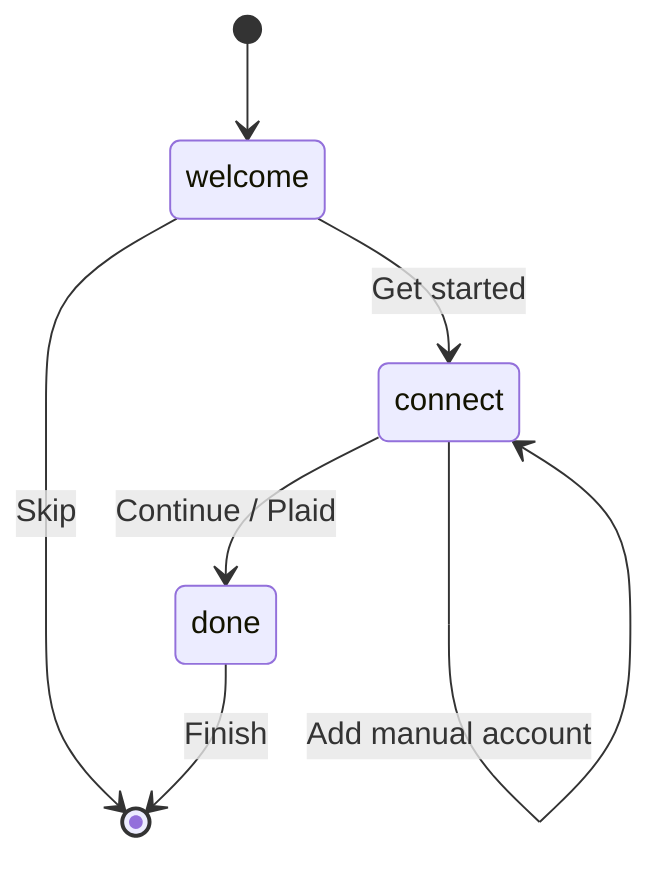
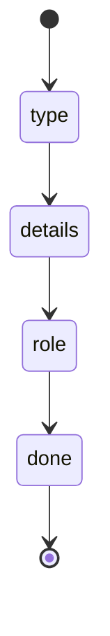
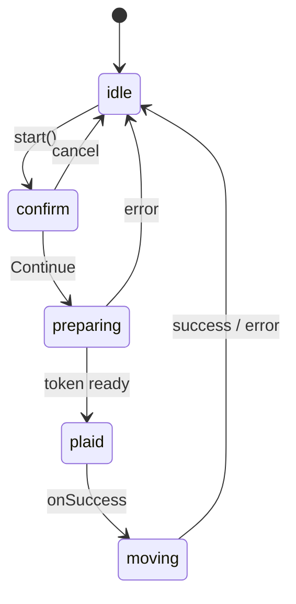
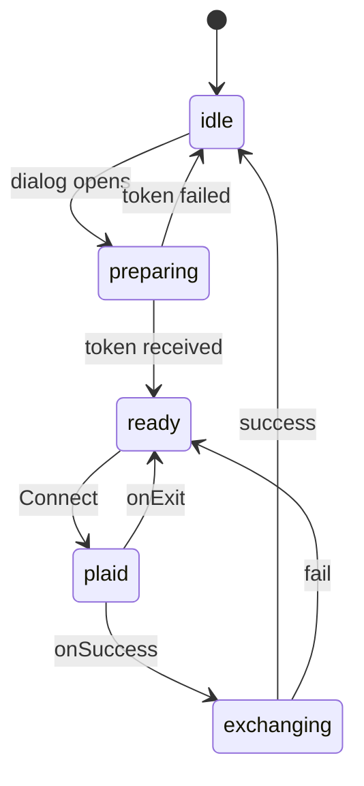

# State Machines in SentryFi

This document catalogs the important state machines (explicit and previously implicit) in the app.

Making flows explicit improves:

- **UX**: Impossible invalid states, clearer progress, reliable error recovery.
- **DX**: Transitions are named and centralized; easier to test and reason about.
- **AX**: Agents can read a union + transition table instead of reverse-engineering scattered `setState` calls.

The app already uses this pattern well in several places. New work should follow it.

## Shared helper

`src/lib/machine.ts` provides a tiny `useMachine` hook:

```ts
const [state, send] = useMachine(initial, transitions);
```

## Explicit machines

### Onboarding (`src/components/Onboarding.tsx`)



### Manual Account Dialog



### Extend History (`useExtendHistory`)



### App Update

```mermaid
stateDiagram-v2
  [*] --> idle
  idle --> checking : checkNow / auto
  checking --> up-to-date
  checking --> available
  checking --> error
  available --> downloading : startUpdate
  downloading --> installing
  downloading --> permission
  permission --> downloading : allowed
  installing --> idle : success
  downloading --> error
  installing --> error
  error --> idle
```

## Recently elevated

### Link Account Dialog

Previously used independent `loading` / `exchanging` / `plaidOpen` booleans.

Now:



### Import Statement Modal

The main flow phases (data arrays remain separate):

- empty → parsing → review → importing → done
- side paths for AI reparse and remove-all

(Full conversion of every boolean is incremental; the phase machine now owns the busy/progress states.)

## Auth context

Implicit machine driven by Supabase `onAuthStateChange` + `loading`:

- loading → authenticated | unauthenticated | disabled

## Guidelines for new flows

1. Prefer a `type Phase = "a" | "b" | "c"` union.
2. Centralize transitions (object or `useMachine`).
3. Drive UI from the phase, not from multiple booleans.
4. Document non-obvious machines here or in the file header.

This pattern keeps the surface area small while making every important user journey predictable for humans and agents.
